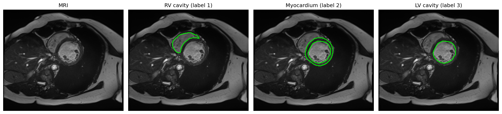
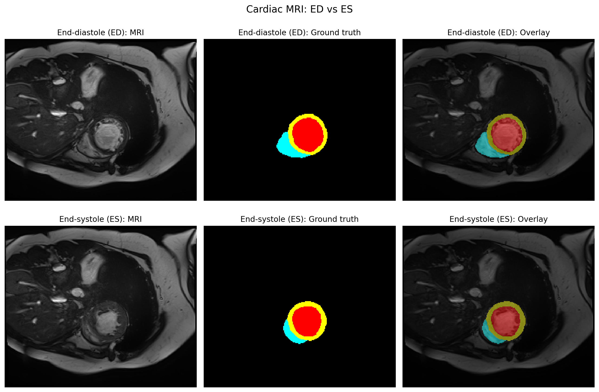
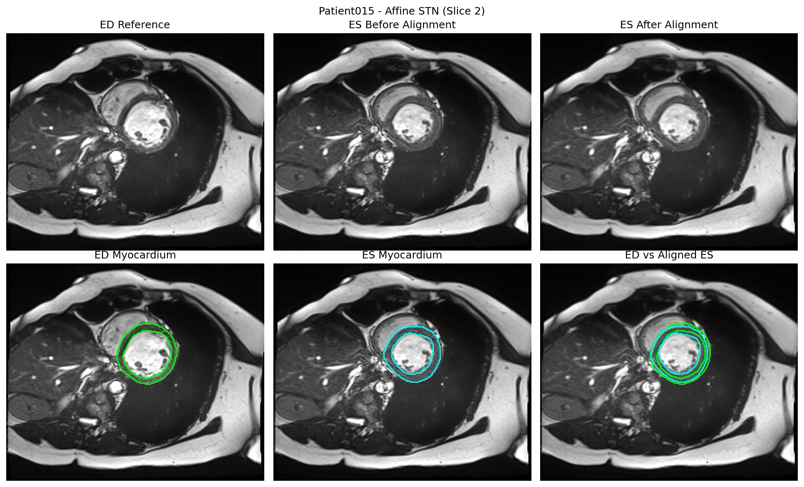
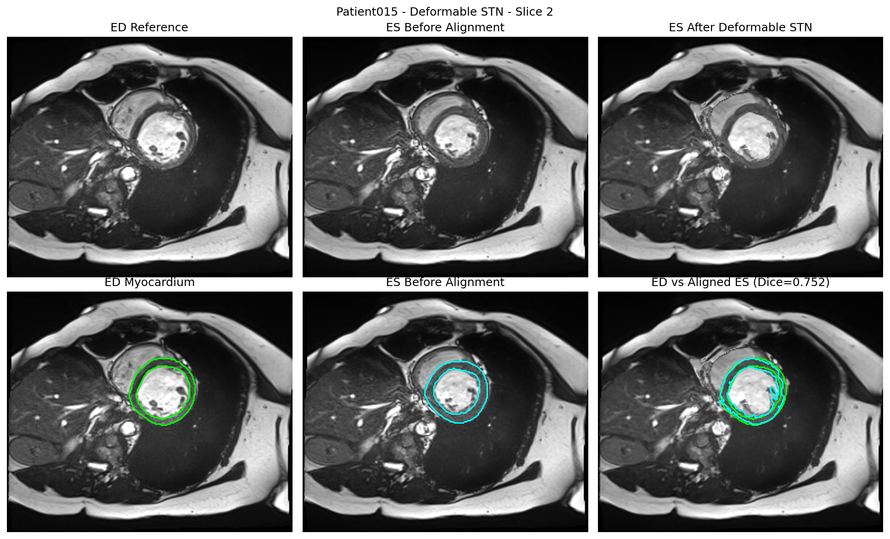
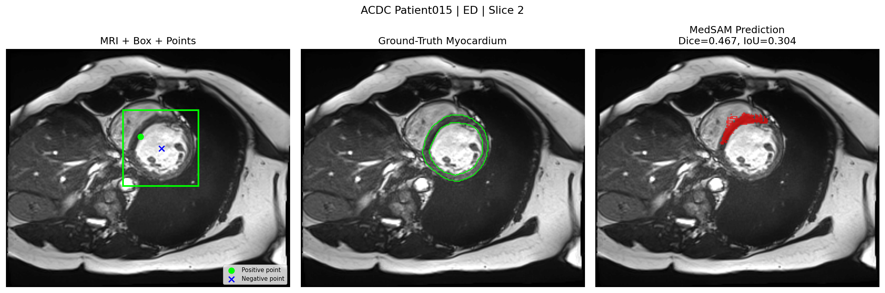
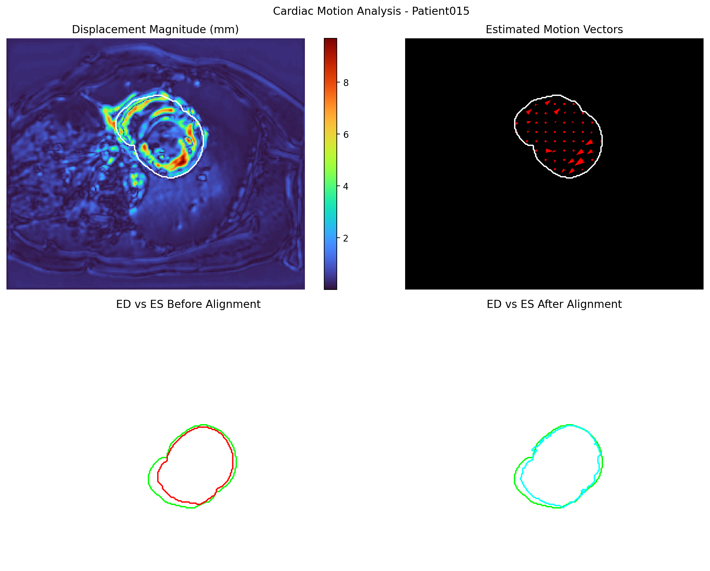

# Cardiac Motion and Wall Thickening Analysis

## Project Overview

This project explores cardiac MRI image alignment, segmentation,
motion estimation, and approximate myocardial wall-thickness analysis.

The experiments use the ACDC cardiac MRI dataset and Patient 015
for the current evaluation.

## Methods

- **Affine STN:** Estimates global image alignment using an affine transformation.
- **Deformable STN:** Estimates a spatial displacement field for image registration.
- **MedSAM:** Used for prompted cardiac image segmentation.
- **Motion Analysis:** Visualizes estimated displacement from the registration field.
- **Wall Thickness Analysis:** Compares approximate thickness estimates before
  and after alignment.

## Dataset

The experiments use Patient 015 from the ACDC dataset.

- ED: End-diastolic phase (frame 01)
- ES: End-systolic phase (frame 10)
- Current registration and motion experiments use 2D slice index 2.

The dataset is not included in this repository.

## Results

The current deformable STN experiment reports:

- MSE before alignment: 0.006782
- MSE after alignment: 0.002385
- NCC before alignment: 0.958774
- NCC after alignment: 0.985540
- Dice before alignment: 0.6227
- Dice after alignment: 0.7517

Motion analysis for Patient 015, slice 2:

- Mean estimated displacement: 2.2954 mm
- Median estimated displacement: 1.4839 mm
- Maximum estimated displacement: 9.6863 mm

Generated figures and CSV files are stored in `results/`.

## Visual Results

### 1. Cardiac MRI Labels


### 2. ED and ES Phase Comparison


### 3. Affine STN Alignment


### 4. Deformable STN Alignment


### 5. MedSAM Segmentation


### 6. Cardiac Motion Analysis



## Limitations

This is an educational project, not a clinically validated system.
Motion values are registration-derived estimates. Wall-thickness values
are approximate geometric measurements.

The MedSAM experiment uses manually supplied prompts derived from
ground-truth information, so it is not a fully automatic segmentation system.

## Running the Experiments

Activate the project's Python environment and install the dependencies:

```bash
pip install -r requirements.txt
```

Run the experiments from the project root:

```bash
python src/stn_alignment.py
python src/deformable_stn.py
python src/evaluate_deformable.py
python src/motion_analysis.py
```

Dataset paths, MedSAM setup, and model checkpoints may need to be
configured for your local environment.
